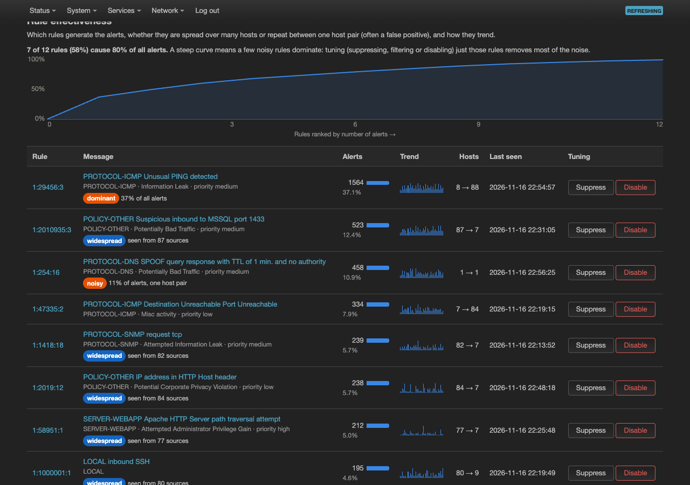
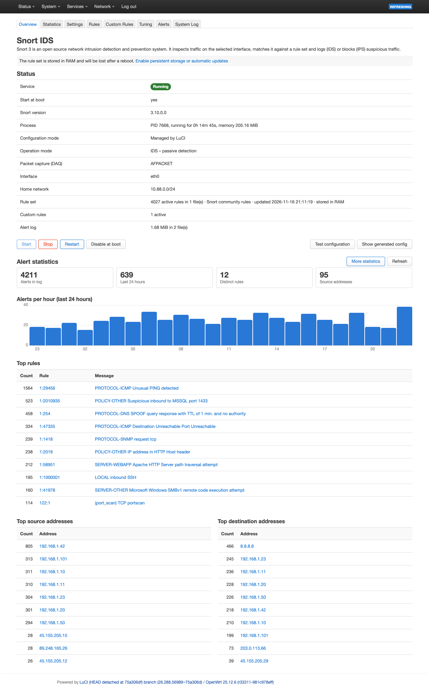
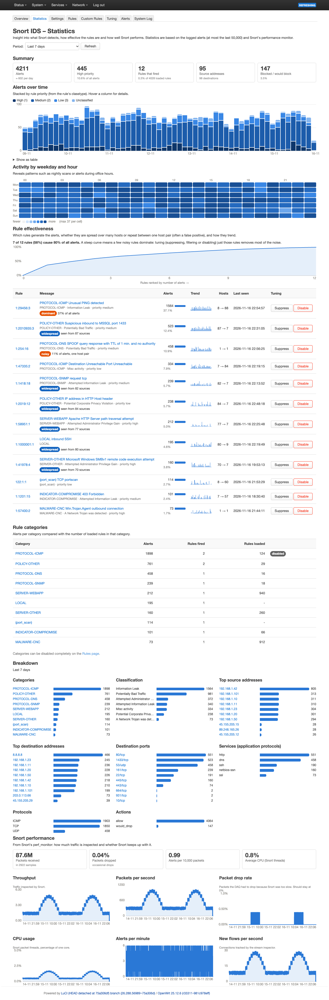
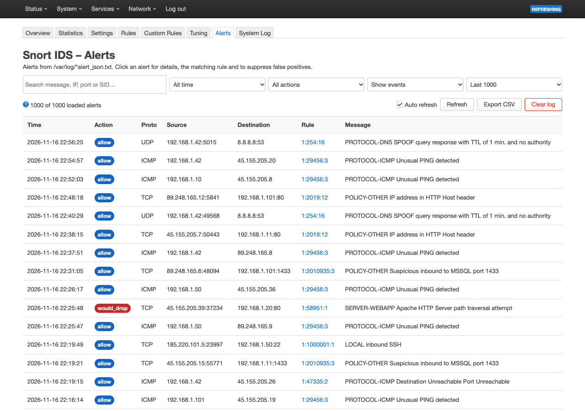
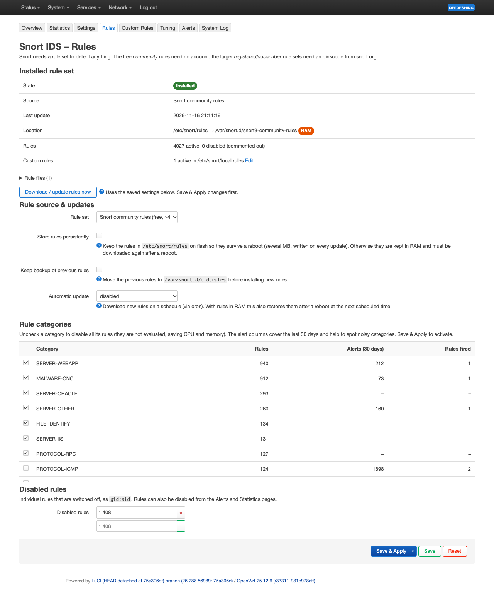
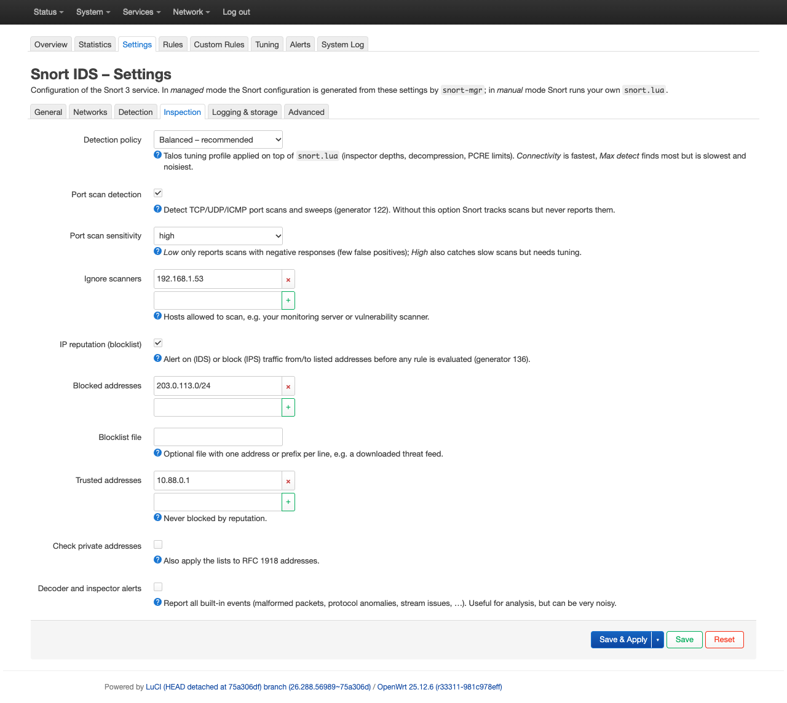
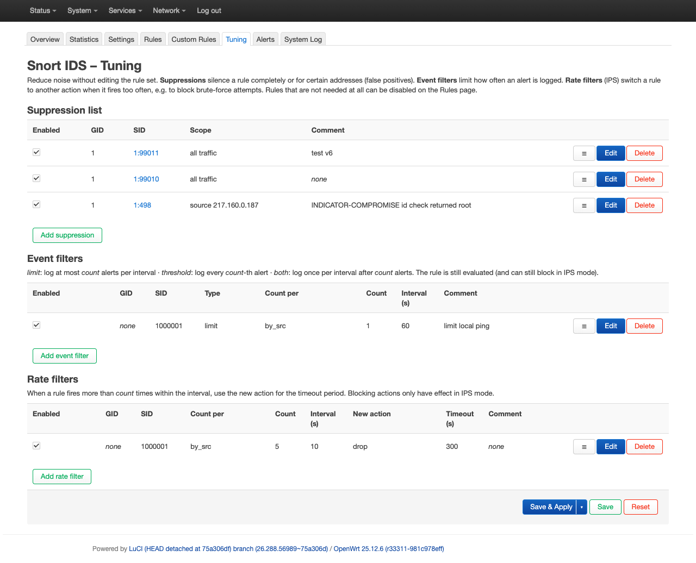

# luci-app-snort3

**A LuCI web interface for the Snort 3 intrusion detection and prevention system on OpenWrt.**

Configure, run, tune and *understand* Snort 3 from your router's web interface: service control, a complete settings editor, rule set and category management, custom rules, suppressions and filters, an alert browser and a statistics dashboard that shows which rules actually earn their keep.




> **Status: 0.1, first public release.** Tested on OpenWrt 25.12.6 (`armsr/armv8`) with `snort3` 3.10.0.0 and LuCI 26.288. Feedback and issues are welcome.

---

## Contents

- [Highlights](#highlights)
- [Screenshots](#screenshots)
- [Requirements](#requirements)
- [Installation](#installation)
- [Quick start](#quick-start)
- [The pages](#the-pages)
- [Reading the statistics](#reading-the-statistics)
- [How it integrates with the snort3 package](#how-it-integrates-with-the-snort3-package)
- [Configuration reference](#configuration-reference)
- [Known issues and tips](#known-issues-and-tips)
- [Development](#development)
- [License](#license)

---

## Highlights

- **Everything in one place.** All options of the `snort3` package (IDS/IPS, DAQ, interface, networks, NFQ queues, logging) plus Snort features the package does not expose: detection policies, port scan detection, IP reputation lists, rule categories, event and rate filters, performance monitoring and rule latency protection.
- **Managed or manual.** Let LuCI generate the complete Snort configuration (recommended), or keep your own `snort.lua` and use LuCI only for control and monitoring.
- **Rule management.** Download community or subscriber rules, update them automatically, store them in RAM or flash, switch whole categories off and disable individual rules.
- **Tuning without editing rules.** Suppress false positives for a rule or a single host, limit noisy alerts with event filters, or block brute force with rate filters. One click from any alert.
- **Statistics that answer real questions.** What is being detected, when, by which rules, between which hosts, and whether Snort keeps up with the traffic. All charts are dependency-free SVG/HTML and work offline, in light and dark themes.
- **Safe by default.** Changes are tested with `snort -T` before Snort is restarted, and a failed rule download restores the previous rules.
- **Translations:** English and Dutch (Nederlands).

## Screenshots

| Overview | Statistics |
|---|---|
| [](docs/screenshots/overview.png) | [](docs/screenshots/statistics.png) |
| **Alerts** | **Rules** |
| [](docs/screenshots/alerts.png) | [](docs/screenshots/rules.png) |
| **Settings → Inspection** | **Tuning** |
| [](docs/screenshots/settings.png) | [](docs/screenshots/tuning.png) |

*The screenshots use generated sample data.*

## Requirements

| | |
|---|---|
| OpenWrt | 25.12 or newer (uses `apk`, ucode rpcd plugins and the JavaScript LuCI API) |
| Packages | `snort3`, `luci-base`, `rpcd-mod-ucode`, `ucode-mod-fs`, `ucode-mod-uci`, `ucode-mod-ubus` |
| Memory | Snort 3 itself needs roughly **200 MB RAM** with the community rules. Plan for at least 512 MB total. |
| Optional | `openappid` (application identification), USB storage for long-term alert logs |

## Installation

### Build with the OpenWrt SDK

```sh
# in the OpenWrt 25.12 SDK
./scripts/feeds update luci && ./scripts/feeds install luci-base
git clone https://github.com/sT0wn-nl/luci-app-snort3.git package/luci-app-snort3
make package/luci-app-snort3/compile
```

This produces `luci-app-snort3-0.1-r1.apk` and `luci-i18n-snort3-nl-*.apk` (architecture-independent). Copy them to the router and install them:

```sh
apk add snort3
apk add --allow-untrusted ./luci-app-snort3-*.apk ./luci-i18n-snort3-nl-*.apk
```

### Try it without building

The app is plain JavaScript, ucode and shell, so you can copy the files straight to a test router:

```sh
apk add snort3 rpcd-mod-ucode
git clone https://github.com/sT0wn-nl/luci-app-snort3.git && cd luci-app-snort3
tar -C root -cf - . | ssh root@router 'tar -C / -xf -'
tar -C htdocs -cf - . | ssh root@router 'tar -C /www -xf -'
ssh root@router 'sh /etc/uci-defaults/80_luci-snort && rm -f /etc/uci-defaults/80_luci-snort; /etc/init.d/rpcd restart; rm -rf /tmp/luci-*'
```

Translations need the package build (it compiles `po/nl/snort3.po` to `.lmo`).

### Upgrading from the old luci-app-snort3

Releases before 0.1 in this repository were based on a different code base. Remove that version first (`apk del luci-app-snort3`) and install 0.1. Your `/etc/config/snort` is kept.

## Quick start

1. **Services → Snort IDS → Settings → General.** Set *Configuration mode* to **Managed by LuCI**, pick the *Interface* (usually your WAN device) and leave *Operation mode* on **IDS**.
2. **Networks.** Choose your LAN subnet(s) as *Home network*.
3. **Detection.** Use **afpacket** as packet capture for IDS. Save & Apply.
4. **Rules.** Choose *Snort community rules*, enable *Store rules persistently* or *Automatic update*, Save & Apply, then click **Download / update rules now**.
5. **General → Enable Snort**, Save & Apply. The Overview should now show *Running*.
6. Watch **Alerts** and **Statistics**, and use **Tuning** to remove false positives.

For **IPS** (blocking): set *Operation mode* to IPS, *Packet capture* to **nfq** and on the *Inline (NFQ)* tab the chain hook to **forward** to inspect traffic between LAN and WAN.

## The pages

### Overview
Service state, process (PID, uptime, memory), version, mode, DAQ, interface, rule set and alert log. Start, stop, restart, enable at boot, **test the configuration** (live output of `snort -T`) and view the generated `snort.lua` or nftables rules. Context-aware notices tell you what needs attention: Snort disabled, manual mode, no rules, rules only in RAM, IPS combined with pcap, logging off, or a **restart required** after a change. A compact 24-hour summary links to the full statistics.

### Statistics
See [Reading the statistics](#reading-the-statistics).

### Settings
| Tab | Options |
|---|---|
| General | enable, managed/manual mode, interface, IDS/IPS |
| Networks | `HOME_NET` (with suggestions from your LAN subnets), `EXTERNAL_NET` |
| Detection | DAQ (afpacket / pcap / nfq), rule action override, snap length, OpenAppID |
| Inspection | **detection policy** (connectivity / balanced / security / max-detect), **port scan detection** with sensitivity and ignore list, **IP reputation** block/allow lists, decoder and inspector alerts |
| Inline (NFQ) | chain hook and priority, queues, queue length, threads, fanout, extra nftables include (only shown for nfq) |
| Logging & storage | alert log on/off, log and working directories |
| Advanced | configuration directory, restart on change, additional include, **performance monitoring**, **maximum alert log size**, checksum verification, **suspend slow rules** |

### Rules
Installed rule set (state, source, last update, RAM or flash, active and commented-out rules per file), rule source and oinkcode, persistent storage, backup, scheduled updates via cron, **rule categories** (switch any category such as `PROTOCOL-ICMP` on or off, with alert counts for the last 30 days) and a list of individually **disabled rules**.

### Custom Rules
An editor for `/etc/snort/local.rules` with live checks for missing or duplicate SIDs, examples, a quick reference, *Save & test configuration* and *Save & Apply* (test, then restart).

### Tuning
- **Suppressions:** silence a rule completely, or only for a source or destination address.
- **Event filters:** `limit`, `threshold` or `both`, per source or destination.
- **Rate filters:** switch a rule to `drop`/`block`/`reject` when it fires too often (IPS), e.g. against brute force.

### Alerts
Search, time range and action filters, an events or grouped-by-rule view, paging, auto refresh, CSV export and clear. Click an alert to see all fields, the matching rule text, the snort.org rule documentation, and one-click actions: *suppress the rule*, *only from this source*, *only to this destination*, or *disable the rule*.

### System Log
Messages from snort, snort-rules, snort-mgr and luci-snort, newest first, with a filter.

## Reading the statistics

The Statistics page covers a selectable period (24 hours, 7 days, 30 days or everything logged). Every chart has tooltips, and the timeline also has a table view.

| Chart | What it tells you |
|---|---|
| **Summary** | Alerts and alerts per day, share of high-priority alerts, how many of the loaded rules fired (**rule coverage**), distinct sources and destinations, and how much was (or would have been) blocked. |
| **Alerts over time** | Stacked by rule **priority** (high, medium, low, unclassified), so a rise in high-priority alerts stands out from background noise. |
| **Activity by weekday and hour** | A heatmap that reveals patterns such as nightly scans, or alerts that only occur during office hours (often legitimate software). |
| **Rule effectiveness** | A cumulative curve that answers *how many rules cause 80% of all alerts?* A steep curve means a handful of noisy rules dominate, and tuning those removes most of the noise. The table lists the top rules with their share, a trend sparkline, how many hosts are involved and when they last fired, with automatic hints: **dominant** (one rule produces a large share), **noisy** (the same host pair over and over, a typical false positive) and **widespread** (many sources, e.g. a scanning campaign). Suppress or disable a rule directly from the table. |
| **Rule categories** | Alerts per category next to the number of rules that fired and the number of rules loaded, to spot categories that are all noise or never relevant. |
| **Breakdown** | Categories, classification, top source and destination addresses, destination ports, services, protocols and actions. |
| **Snort performance** | From Snort's `perf_monitor`: throughput, packets per second, **packet drop rate** (should stay at 0%; anything else means Snort cannot keep up), CPU usage of the packet threads, alerts per minute, new flows per second, alerts per 10,000 packets and rule time-outs. |

Charts use a single colour for single measures and a one-hue ordinal ramp for priority. Both were checked for contrast and colour-vision deficiencies in light and dark mode. Identity is never colour alone: legends, labels and tooltips name every series.

## How it integrates with the snort3 package

The app reuses the mechanisms of the `snort3` package instead of replacing its files:

- **Configuration** lives in `/etc/config/snort`. The sections `snort` and `nfq` belong to the snort3 package. The app adds a `luci` section and `suppress`, `event_filter` and `rate_filter` sections, which `snort-mgr` ignores.
- **Generated configuration.** `snort-mgr` renders `snort.lua` and includes the file named in `snort.snort.include`. On installation that option is pointed to `/usr/share/luci-app-snort/include.uc`, an existing value is preserved as `snort.luci.user_include` and still included, and on removal the original value is restored. The template adds the detection policy, port scan, reputation, custom rules (`ips.include`), disabled rules and categories (`ips.states`), suppressions and filters, extra alert fields (`class`, `priority`, `service`, `seconds`), the alert log size limit and `perf_monitor`. These features therefore require **managed** mode.
- **Restart on change.** The snort3 init script regenerates its configuration on a UCI change but does not restart the running daemon, so changes would not take effect. The companion service `/etc/init.d/luci_snort` (no daemon, only a procd reload trigger) restarts Snort after *Save & Apply*, but only if the configuration test passes. It also keeps the cron entry for automatic rule updates in sync.
- **Backend.** An rpcd ucode plugin (`ubus` object `luci.snort`) provides status, statistics, performance data and rule information. `/usr/libexec/luci-snort/helper` runs long jobs (rule download, configuration test) in the background, and the UI shows their live output.

## Configuration reference

Options in `config luci 'luci'` of `/etc/config/snort`:

| Option | Default | Meaning |
|---|---|---|
| `rules_source` | `community` | `community`, `subscription` (needs `snort.snort.oinkcode`) or `testing` |
| `rules_persist`, `rules_backup` | `0` | store rules in flash / keep the previous rules |
| `auto_update`, `update_hour`, `update_restart` | `0`, `3`, `1` | `daily` or `weekly` rule updates via cron |
| `restart_on_change` | `1` | restart Snort after Save & Apply |
| `local_rules` | `/etc/snort/local.rules` | custom rules file |
| `user_include` | | additional ucode/Lua include |
| `policy` | | `connectivity`, `balanced`, `security` or `max_detect` |
| `portscan`, `portscan_level`, `portscan_ignore` | `0`, `med` | port scan detection (`low`, `med`, `hi`), list of ignored scanners |
| `reputation`, `reputation_block`, `reputation_allow`, `reputation_blocklist`, `reputation_scan_local` | `0` | IP reputation lists |
| `builtin_rules` | `0` | report all built-in decoder and inspector events |
| `disabled_category`, `disabled_sid` | | lists of categories and `gid:sid` rules to disable |
| `perfmon`, `perfmon_interval` | `1`, `60` | performance monitoring |
| `alert_limit` | `10` | alert log size in MB before rollover (0 = unlimited) |
| `checksum_eval` | `1` | verify checksums (disable with checksum offloading) |
| `latency_suspend`, `latency_rule_max` | `0`, `500` | suspend rules slower than *n* µs |

Example:

```
config event_filter
	option sid '2010935'
	option type 'limit'
	option track 'by_src'
	option count '1'
	option seconds '3600'
	option comment 'one MSSQL probe alert per source per hour'
```

## Known issues and tips

- **`snort-mgr update-rules` is broken** in snort3 3.10.0.0-r1 (it evaluates `update-rules` instead of `update_rules`). This app calls `snort-rules` directly.
- **pcap buffers alerts.** With the pcap DAQ, alerts may only appear when the buffer fills or Snort stops. Use **afpacket** for IDS.
- **Port scan detection** is configured in the default `snort.lua` but never reports anything without builtin rule stubs. The *Port scan detection* option adds them.
- **Rules and logs in RAM.** By default rules and alerts live in `/var` and are lost after a reboot. Enable persistent rules or automatic updates. For long-term alerts use a log directory on USB storage, never the internal flash.
- **Checksum offloading.** If locally generated traffic is not inspected, disable *Verify checksums* (Settings → Advanced).
- **Multiple packet threads** (NFQ) write `N_alert_json.txt` files; the app reads all of them.
- **Subscriber rules.** `snort-rules` downloads a fixed Snort version snapshot. Check that it matches your Snort build.

## Development

```
htdocs/luci-static/resources/snort/common.js      shared helpers (RPC, badges, jobs, tuning actions)
htdocs/luci-static/resources/snort/charts.js      dependency-free chart kit (columns, line, heatmap, bars, sparkline)
htdocs/luci-static/resources/view/snort/*.js      the eight views
root/usr/share/rpcd/ucode/luci.snort              rpcd backend (ubus object luci.snort)
root/usr/share/rpcd/acl.d/luci-app-snort3.json    ACL
root/usr/share/luci/menu.d/luci-app-snort3.json   menu
root/usr/share/luci-app-snort/include.uc          snort.lua include (policy, inspectors, rules, filters)
root/usr/libexec/luci-snort/helper                background jobs, rule update, cron, apply, uninstall
root/etc/init.d/luci_snort                        procd reload trigger
root/etc/uci-defaults/80_luci-snort               first-install setup
po/templates/snort3.pot, po/nl/snort3.po          translations
tools/extract.py, tools/mkpo.py, tools/nl.json    regenerate POT / Dutch PO
```

After changing UI strings, run `python3 tools/mkpo.py`. It regenerates the template and the Dutch catalogue from `tools/nl.json` and reports missing translations.

The app was developed and tested in the official `openwrt/rootfs:armsr-armv8-25.12.6` container image with podman (`--cap-add NET_RAW,NET_ADMIN`).

## License

[Apache License 2.0](LICENSE), like LuCI itself. Snort is a trademark of Cisco Systems, Inc. This project is not affiliated with Cisco or the OpenWrt project.
